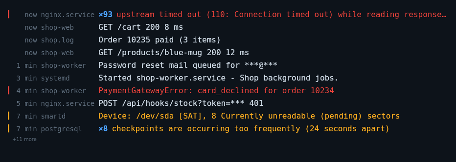
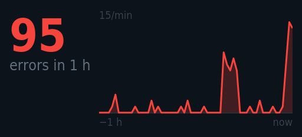
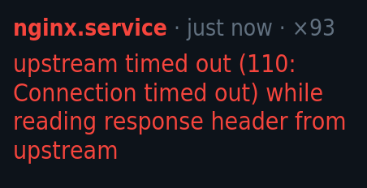

# kiosko-plugin-logs

Live logs on your panel: the end of your logs as they are written, errors per
minute as a curve, and the last error, big. Errors show as they happen and
keep their tile a while; repeats fold into one line ("×37"); tokens,
passwords and e-mail addresses are masked before anything is kept or painted.

From **journald**, **log files**, **Docker** containers, the **macOS** unified
log, the **Windows** Event Log, **Kubernetes** pods and **Grafana Loki**.

A plugin for [Kiosko](https://github.com/kiosko-lcd/kiosko), the widget mosaic
for small USB LCD panels. **Optional:** Kiosko doesn't install it.



## Install

In Kiosko, **Plugins → Install from npm** → `kiosko-plugin-logs`. Or from a
terminal:

```sh
npm install --prefix ~/.config/kiosko/plugins kiosko-plugin-logs
```

(macOS: `~/Library/Application Support/Kiosko/plugins`, Windows: `%APPDATA%\Kiosko\plugins`.)

Then tell it what to follow in **Settings → Data sources** (one source per
kind of log, below) and add a widget. Out of the box only the system's own
log is followed, on its own system: the journal on Linux, the unified log
(errors only) on macOS, the System and Application logs (warnings and worse)
on Windows. Files, Docker, Kubernetes and Loki do nothing until you set them
up.

## What it does on your machine

Be sure you want this before you turn a source on. Logs say a lot about a
machine and the people who use it.

- **Runs** `journalctl` (Linux), `log stream` (macOS), `powershell.exe`
  (Windows, every 15 s) and `kubectl` (only with pods chosen), or the program
  you name in each source's `bin`. Each is restarted when it dies, waiting
  longer each time (1 s, 2 s, 4 s… up to a minute).
- **Reads** the log files you list, following their end like `tail -F`.
- **Talks to Docker** through its socket, only with `GET` requests (list the
  containers, read their logs). Nothing is started, stopped or changed.
- **Contacts** the Loki you name, and your Kubernetes cluster through your
  kubeconfig. Nothing else on the network.

### Permissions, honestly

- **The system journal** needs your user in the `systemd-journal` (or `adm`)
  group. Without it `journalctl` shows only your own user's messages, which
  is often what you want on a desktop: Kiosko never asks for more, and it
  doesn't need root.
- **The Docker socket is root.** Anyone who can write to
  `/var/run/docker.sock` can start a container that mounts `/` and do
  anything to the machine. This plugin only reads, but giving Kiosko's user
  the `docker` group gives that power to everything running as that user.
  Rootless Docker (its socket is `$XDG_RUNTIME_DIR/docker.sock`, found on its
  own) doesn't have that problem. Docker is read only once you choose
  containers.
- **Windows**: the Security log needs an administrator; System and
  Application don't.
- **macOS**: `log stream` works for any user; some private details are
  redacted by macOS itself.
- **Kubernetes** and **Loki** see what your kubeconfig and your Loki token
  allow.

### What is masked

Before a line is kept, shown or sent to the editor:

- passwords in URLs (`postgres://app:***@db:5432`);
- `Authorization: Bearer ***`, `Basic ***`, `token ***`;
- values of `password`, `token`, `secret`, `api_key`, `session`, `cookie` and
  the like, in `key=value`, `key: value` and JSON;
- well-known token formats anywhere in a line: GitHub, GitLab, Slack, AWS,
  Google, `sk-…` API keys, Stripe, Hugging Face, npm, JSON Web Tokens,
  private key blocks;
- e-mail addresses (`***@***`).

It errs on the side of hiding, but it can't know every secret format: a
panel on a shelf is seen by anyone walking by, so think about which logs you
put on it. Lines are cut to 400 characters, and at most 300 lines and 1000
warnings and errors (24 h) are kept per source, in memory only.

## Sources

Edited once, in **Settings → Data sources**. A widget shows the lines of
every source that is set up; its `units` filter picks among them.

### systemd journal — `logs/journal` (Linux)

`journalctl --follow --output=json`, the last 200 lines first. After a
restart it goes on from where it was (`--after-cursor`), so nothing is shown
twice.

| Option | Type | Default | |
|---|---|---|---|
| `units` | filter | `[]` | Which units: `nginx.service`, `backup*`, `!cron.service`. Empty: all. |
| `priority` | `error` … `debug` | `info` | The least serious messages read (`--priority`). |
| `onlyUser` | boolean | `false` | Only your user's journal (`--user`). |
| `bin` | program | `""` | `journalctl` by its full path. |

### Log files — `logs/file`

Follows the end of each file like `tail -F`: the last lines first, then what
is appended. Rotation by renaming (logrotate) is noticed and the new file is
read from its start; truncation in place (`copytruncate`, `> app.log`) starts
again from the top; a file that isn't there yet is waited for. A file
growing faster than a panel can show is skipped forward. Lines are read for
their own timestamp (ISO, syslog) and level (`ERROR`, `[warn]`,
`level=error`, JSON `"level"`, glog's `E1121`).

| Option | Type | Default | |
|---|---|---|---|
| `paths` | list of paths | `[]` | The files, by full path (`~` and `$VARS` work). Empty: none is read. |

### Docker containers — `logs/docker`

Through Docker's API on its socket: the running containers your filter
picks, followed with timestamps, frames read whether the container has a
TTY or not. New and restarted containers are picked up within 15 s, from
where they were left.

| Option | Type | Default | |
|---|---|---|---|
| `containers` | filter | `[]` | By name or Compose service: `web`, `db-*`, `!*-test`; `*` for all. **Empty: Docker is not read.** |
| `socket` | path | `""` | Empty: `DOCKER_HOST`, else `$XDG_RUNTIME_DIR/docker.sock` (rootless), `~/.docker/run/docker.sock` (Docker Desktop), `/var/run/docker.sock`; on Windows `\\.\pipe\docker_engine`. |

### macOS unified log — `logs/macos`

`log stream --style ndjson`. The whole log is thousands of lines a second,
so by default only errors and faults.

| Option | Type | Default | |
|---|---|---|---|
| `predicate` | text | `messageType == error OR messageType == fault` | As `log stream --predicate` takes it. Empty: everything. |
| `level` | `default` \| `info` \| `debug` | `default` | `--level`. |
| `bin` | program | `""` | `/usr/bin/log`. |

### Windows Event Log — `logs/windows`

`Get-WinEvent` through PowerShell every 15 seconds (Windows has no `-f`),
new events only.

| Option | Type | Default | |
|---|---|---|---|
| `logs` | list | `["System", "Application"]` | Event log names. |
| `priority` | `error` \| `warning` \| `info` | `warning` | The least serious events read. |
| `bin` | program | `""` | `powershell.exe`. |

### Kubernetes pods — `logs/kubernetes`

`kubectl logs --follow --timestamps --prefix --all-containers`, with your
kubeconfig.

| Option | Type | Default | |
|---|---|---|---|
| `selector` | text | `""` | A label selector (`app=shop`) or a resource (`deployment/shop`). **Empty: kubectl is not run.** |
| `namespace` | text | `""` | |
| `context` | text | `""` | The kubeconfig context; empty, the current one. |
| `bin` | program | `""` | `kubectl`. |

### Grafana Loki — `logs/loki`

Loki's tail API (`/loki/api/v1/tail`, a WebSocket) for a LogQL query.

| Option | Type | Default | |
|---|---|---|---|
| `url` | URL | `""` | `http://loki.example.lan:3100`. `user:password@` in it becomes Basic auth. **Empty: Loki is not contacted.** |
| `query` | LogQL | `""` | `{job="nginx"} \|= "error"`. |
| `token` | secret | `""` | Sent as `Authorization: Bearer`. |
| `orgId` | text | `""` | `X-Scope-OrgID`, for a multi-tenant Loki. |

## Widgets

All three take the same filters:

- `units`: which logs, by name (`nginx.service`, `web`, `app.log`) or kind
  (`journal/*`, `docker/*`, `file/*`, `macos/*`, `windows/*`,
  `kubernetes/*`, `loki/*`), with `!` to leave one out.
- `messages`: only lines with these words (`timeout`, `refused`), `!` to
  leave out (`!healthcheck`), globs (`GET *`) and regular expressions
  between slashes (`/5\d\d/`, case-insensitive unless it has capitals).
- `holdMs`: how long an error keeps the tile (urgent, while the instance's
  **Keep the tile while urgent** is on); 0, never. Default 2 min.

They are **idle** when no warning or error has come for 10 minutes, so a
screen with *sleep when idle* goes dark while the logs are quiet.

### Live log — `logs/tail`

The end of the logs, newest first, in monospace: how long ago, where from,
"×37" for repeats, errors in red and warnings in amber. "+N more" counts the
older lines left out.

| Option | Type | Default | |
|---|---|---|---|
| `level` | `error` … `debug` | `info` | The least serious lines shown. |
| `units`, `messages` | filter | `[]` | See above. |
| `showUnits` | boolean | `true` | Where each line comes from. |
| `showTime` | boolean | `true` | How long ago. |
| `rows`, `layout` | list options | `0`, `auto` | As in every Kiosko list; `detailed` puts the unit and age under each line. |
| `holdMs` | duration | 2 min | |

### Errors per minute — `logs/rate`



How many errors in the span, and a curve of them minute by minute (warnings
too, in amber, with `includeWarnings`).

| Option | Type | Default | |
|---|---|---|---|
| `units`, `messages` | filter | `[]` | |
| `includeWarnings` | boolean | `false` | |
| `historyMs` | duration | 1 h | 10 min to 24 h. |
| `holdMs` | duration | 2 min | |

### Last error — `logs/last-error`



The last error, as big as it fits, with where, when and how many times. Red
while fresh (`holdMs`), plain afterwards.

| Option | Type | Default | |
|---|---|---|---|
| `units`, `messages` | filter | `[]` | |
| `includeWarnings` | boolean | `false` | |
| `holdMs` | duration | 2 min | |

## Testing

`npm test`: the parsers (journald, Docker frames, macOS, Windows, kubectl,
Loki, plain lines), masking, folding and the buffer, the once-a-second
emitter, the restarts with backoff, file following with real rotation and
truncation, journald through a stand-in `journalctl`, Docker through a
stand-in API on a Unix socket, and the widgets painted with
`@kiosko/sdk/testing`. Every log line in the tests, the demo and the
pictures is invented.

## Not yet

- Receiving **syslog over UDP** from the network (a router, a NAS).

## Licence

MIT.
